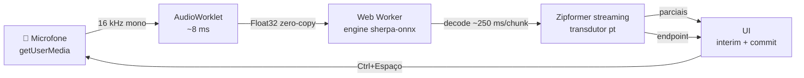

<div align="center">

# 🎙️ Digitação por Voz

**Reconhecimento de voz 100% offline no navegador — streaming em tempo real, sem internet, sem nuvem**

Clone open-source do *"Digitação por Voz"* do Windows (Win+H), rodando inteiramente em WebAssembly.

[](https://github.com/EdysonAcioli/voice-typing-js)
[](https://webassembly.org/)
[](https://huggingface.co/kouhxp/sherpa-onnx-streaming-zipformer-pt-kroko)
[](#-latência)
[](LICENSE)

</div>

---

## ✨ O que é

Um app de ditado que roda **inteiramente no navegador**, com o modelo de reconhecimento
de fala compilado para WebAssembly. Nada de áudio saindo da sua máquina:

- 🎯 **Streaming de verdade** — o texto aparece *enquanto* você fala (parciais incrementais), como no Win+H
- 🔒 **Zero rede** — modelo Zipformer pt de 155 MB carregado uma única vez; depois, funciona no avião
- ⚡ **Latência baixa** — primeira parcial em ~1,7s; engine isolado em Web Worker
- 🇧🇷 **Português nativo** — modelo streaming pt treinado pela [Kroko](https://kroko.ai)
- 🆓 **Grátis e aberto** — sem API key, sem limite de uso, sem telemetria

## 🚀 Como rodar

```powershell
# 1. Baixar o modelo (~170 MB, uma vez só)
powershell -File scripts\download-model.ps1

# 2. Servir (precisa de servidor local por causa dos headers WASM)
python server.py

# 3. Abrir http://localhost:8765 e apertar Ctrl+Espaço
```

> Requer Python 3 ou qualquer servidor estático com headers
> `Cross-Origin-Opener-Policy`/`Cross-Origin-Embedder-Policy` (o `server.py` já cuida disso).

## 🏗️ Arquitetura

Mesma arquitetura do SDK oficial da Kroko (fornecedor do modelo), validada por
engenharia reversa do demo deles: **o engine inteiro roda num Web Worker dedicado**.



| Camada | Arquivo | Papel |
|---|---|---|
| UI + captura | [`app.js`](app.js) | Main thread: getUserMedia, AudioWorklet, renderização |
| Engine | [`engine-worker.js`](engine-worker.js) | Web Worker: sherpa-onnx WASM, decode incremental |
| Captura | [`voice-capture-worklet.js`](voice-capture-worklet.js) | AudioWorklet processor (128 samples ≈ 8 ms) |
| Loader | [`sherpa-wasm/`](sherpa-wasm) | sherpa-onnx v1.13.5 WASM + modelo pt empacotado |

**Decisões-chave de performance:**

1. **Engine em Web Worker** — o decode (~250 ms/chunk) nunca compete com a UI nem com a captura de áudio
2. **AudioWorklet** — buffer de ~8 ms (vs. 256 ms do ScriptProcessor)
3. **Warm-up** — 3s de silêncio decodados no boot eliminam o custo frio do primeiro decode
4. **Zero-copy** — chunks de áudio transferidos via `postMessage` com transferable buffers
5. **Endpoint detection** — commit automático em pausas (regra 1,2s), como o Win+H

## ⚡ Latência

Medida com áudio de teste pt-BR (onset → primeira parcial visível):

| Etapa | Tempo |
|---|---|
| Captura (AudioWorklet) | ~8 ms |
| Piso do modelo (1ª janela do Zipformer) | 1430 ms |
| Decode (quente, no worker) | ~250 ms |
| **Total esperado** | **~1,7 s** |

> O *"Digitação por Voz"* do Windows começa a transcrever em ~1,6s. A diferença
> restante é o piso do modelo Zipformer (1430 ms de áudio antes da primeira
> janela) — incompressível sem trocar de modelo, e não existe modelo pt
> streaming com janela menor disponível hoje.

## 📁 Estrutura

```
voice-typing-js/
├── index.html                 # UI (dark, minimalista)
├── app.js                     # Main thread: captura + render
├── engine-worker.js           # Web Worker: engine WASM
├── voice-capture-worklet.js   # AudioWorklet de captura
├── server.py                  # Servidor local (COOP/COEP)
├── sherpa-wasm/               # sherpa-onnx WASM + modelo (via script)
└── scripts/
    ├── download-model.ps1     # Baixa modelo + wasm do HF/GitHub
    ├── patch-loader.ps1       # Empacota .onnx no .data do emscripten
    └── gen-test-wav.ps1       # Gera WAV de teste (voz SAPI pt-BR)
```

## 🔧 Como funciona o empacotamento do modelo

O loader do sherpa-onnx espera um único arquivo `.data` (formato pacote do
emscripten) com offsets fixos. O [`scripts/patch-loader.ps1`](scripts/patch-loader.ps1)
concatena `encoder.onnx` + `decoder.onnx` + `joiner.onnx` + `tokens.txt` e
reescreve os offsets no loader JS — assim o modelo pt carrega no mesmo
pipeline do modelo en original.

## 🙏 Créditos

- **[sherpa-onnx](https://github.com/k2-fsa/sherpa-onnx)** — runtime ASR streaming em WASM (k2-fsa)
- **[Kroko](https://kroko.ai)** — modelo Zipformer streaming pt ([kouhxp/sherpa-onnx-streaming-zipformer-pt-kroko](https://huggingface.co/kouhxp/sherpa-onnx-streaming-zipformer-pt-kroko))
- Arquitetura worker-first inspirada no demo oficial da Kroko (analisado por engenharia reversa)

## 📄 Licença

[MIT](LICENSE) — código deste repositório. O modelo e o sherpa-onnx têm suas
próprias licenças (Apache-2.0 / CC).
